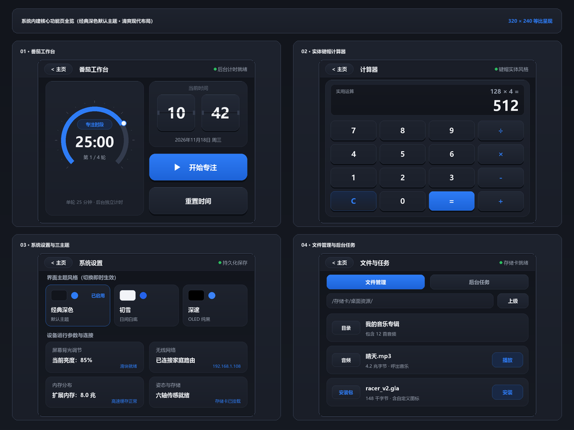
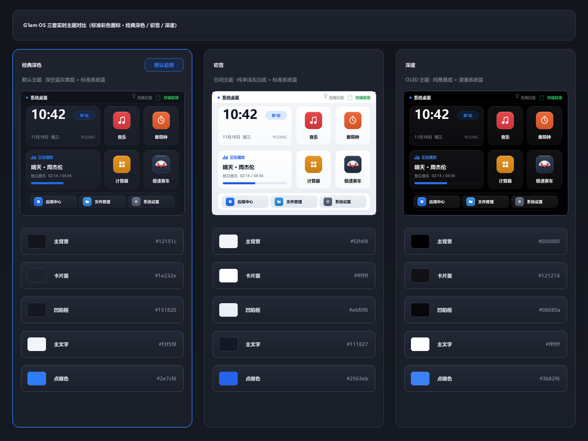

# G'lam OS — ESP32-S3 Dynamic PSRAM ELF Operating System

<p align="center">
  <b>不止是固件，而是运行在 ESP32-S3 上的真·动态应用操作系统</b><br>
  <b>A True Dynamic ELF Operating System for ESP32-S3 (16MB Flash + 8MB Octal PSRAM)</b><br><br>
  <a href="#中文文档">🇨🇳 中文文档</a> &nbsp;|&nbsp; <a href="#english-documentation">🇺🇸 English Documentation</a> &nbsp;|&nbsp;
  <a href="https://github.com/mark3268867477-spec/Glamor">🛠️ 配套 PC 控制器与 SDK (G'lamor)</a>
</p>

---

<a id="中文文档"></a>
# 🇨🇳 中文文档

> 🔗 **配套第三方应用开发控制器与 SDK 仓库**：  
> 如果你是应用开发者，想要在不配置 ESP-IDF 环境的情况下为 G'lam OS 编写 C 语言应用、进行 ABI 安全体检并打包 `.gla` 安装到设备，请前往配套仓库：  
> 👉 **[G'lamor — G'lam OS 官方零环境开发控制器 & C/ELF SDK (`mark3268867477-spec/Glamor`)](https://github.com/mark3268867477-spec/Glamor)**  
> 📦 **[直接下载 Windows 零环境免安装绿色版 `Glamor_v1.0.0_Win64_Portable.zip`](https://github.com/mark3268867477-spec/Glamor/releases/latest)**

---

## 一、 为什么 G'lam OS 与众不同？（系统核心特色）

绝大多数 ESP32 项目都是**“单体静态固件”**——每加一个新功能或小游戏，都必须重新编译整个工程并擦写一次片内 Flash。  
**G'lam OS** 从底层彻底打破了这一限制，在微控制器上实现了接近现代智能手机的应用运行机制：

1. **🔄 系统与软件物理隔离，装 App 永不刷砖**：  
   片内 16MB Flash **只驻留 OS 内核与硬件驱动**；所有内置及第三方应用均以独立可重定位 **Xtensa ELF32 (`app.elf`)** 打包为 **`.gla`**，存放在外部 TF 卡 `/sdcard/apps/`。安装、升级、卸载任何应用**100% 不触碰片内 Flash、无需重新烧录、无需重启**，安装完成桌面秒级刷新即刻启动。
2. **⚡ 8MB Octal PSRAM 双总线原生机器码执行**：  
   不是慢速的脚本解释器，而是真正的 **C 语言原生机器码**！内核内置 `Xtensa ELF32` 加载器，直接在 **8MB Octal PSRAM** 中分配数据区（`DBUS 0x3Cxxxxxx`）并映射指令总线别名（`IBUS 0x42xxxxxx`），完成段重定位与 `D-Cache / I-Cache` 同步后以 **240MHz 原生全速运行**。
3. **🛡️ 17 项内核导出符号白名单 + 沙盒目录隔离**：  
   第三方 `.elf` 应用无法直接调用 Flash 擦写或越权系统函数，只能通过内核注入的 **`glam_os_api_t` (ABI v1)** 函数指针表与严格审计的 **17 个安全白名单符号** 与硬件交互，所有应用存档严格隔离在 `/sdcard/data/<app_id>/`。
4. **📱 手机级三级后台生命周期管理（0% CPU 冻结 + 0 秒瞬时唤醒）**：  
   首创面向 MCU 的三级后台策略（`kill_all` / `partial_service` / `keep_all`）。工具类应用切回桌面时，可**完整保留 PSRAM 现场并自动冻结全部定时器（后台 0% CPU 占用）**，从后台管理切回时 **0 秒恢复现场**；配合 `5` 任务上限与低内存 LRU 自动淘汰机制，保证系统永不卡顿。
5. **🎨 320×240 Bento 现代桌面 + 三套实时热切换主题**：  
   基于 LVGL 8.3 打造的非对称 Bento 磁贴桌面，内置 **经典深色 / 初雪 / 深邃** 三套高对比度主题（一键切换即时生效且 NVS 持久化）、全局 24 键中英拼音输入法、GB2312 一二级汉字字库，并与独立音乐中心实现动态播放条联动。
6. **📡 三通道热装包 + 真机实时投屏**：  
   支持 **Wi-Fi 网页与 REST API**（含 320×240 实时截图投屏接口）、**USB 串口直推**、**TF 卡文件管理点击直装** 三种免刷机装包方式。

---

## 二、 系统界面预览（最新版模拟截图）

| Bento 主桌面与动态磁贴（经典深色） | 应用中心与自定义图标机制 |
| :---: | :---: |
|  |  |
| **内建工具矩阵（番茄钟 / 计算器 / 设置 / 文件与任务）** | **三套实时切换主题（经典深色 / 初雪 / 深邃）** |
|  |  |

---

## 三、 核心架构深度解析

### 1. Xtensa ELF32 动态 PSRAM 加载器 (`swift_elf_loader`)
* 解析标准 ELF32 节头表，按 64 字节对齐在 **8MB Octal PSRAM** 中分配合并内存块（`DBUS 0x3Cxxxxxx`），并自动换算对应的指令总线可执行别名（`IBUS 0x42xxxxxx`）。
* 完整处理 `SHF_ALLOC` 节加载与 `SHT_RELA` 重定位（支持 `R_XTENSA_32`、`R_XTENSA_JMP_SLOT`、`R_XTENSA_RELATIVE`、`R_XTENSA_SLOT0_OP`）。
* 通过 `esp_cache_msync()` 自动完成 **D-Cache 回写 (`C2M`)** 与 **I-Cache 失效 (`M2C`)**，确保刚写入 PSRAM 的指令能被 CPU 正确取指执行。

### 2. 三级后台生命周期策略 (`bg_policy`)
| 策略 | 适用场景 | 切回桌面时的系统行为 |
| :--- | :--- | :--- |
| **`kill_all`** | 游戏、一次性工具 | 立即调用 `on_destroy()` 并释放全部 PSRAM，不驻留后台 |
| **`partial_service`** | 音乐中心、番茄钟 | 释放前台 UI 控件，仅在音频播放或倒计时进行中保留后台服务槽位 |
| **`keep_all`** | 内存探针等持续工具 | 完整保留 PSRAM 现场并自动**冻结应用定时器（后台 0% CPU 占用）**，支持 0 秒瞬时恢复 |

### 3. 三通道 `.gla` 安全应用安装器 (`os_spk_installer`)
系统原生支持 `.gla`（`GLAM` 魔数，并向下兼容旧版 `.spk` / `SWPK` 魔数）：
* **通道 1 — Wi-Fi 无线网页与 REST API**（端口 `80`）：
  * `GET /`：内置无线安装网页，手机/电脑浏览器可直接上传 `.gla`
  * `POST /api/install`：校验 CRC32 与 Xtensa ELF 头后自动解包并提取 40×40 图标至 `/sdcard/apps/<id>/`
  * `GET /api/info` & `GET /api/apps`：查询 PSRAM/SRAM 水位与已安装应用列表
  * `POST /api/uninstall?id=<app_id>`：远程卸载应用
  * `GET /api/screenshot`：抓取 320×240 24-bit BMP 实时屏幕快照（供 **[G'lamor](https://github.com/mark3268867477-spec/Glamor)** 实时投屏）
* **通道 2 — USB 串口热推包**（`115200` bps）：开机状态下通过 `gla_begin` / `gla_chunk` / `gla_end` JSON+Base64 协议安全写入 TF 卡。
* **通道 3 — TF 卡离线导入**：将 `.gla` 放入 `/sdcard/install/` 自动扫描安装，或在「文件管理」中直接点击任意 `.gla` 文件一键安装。

---

## 四、 目标硬件配置与引脚定义

| 模块 | 型号 / 规格 | 接口与引脚定义 |
| :--- | :--- | :--- |
| **主控模组** | `ESP32-S3-WROOM-1-N16R8` | 双核 Xtensa LX7 @ 240MHz，16MB Quad Flash，8MB Octal PSRAM |
| **显示屏** | 2.0" IPS LCD `ST7789` (320×240) | SPI2: `MOSI=IO40`, `CLK=IO41`, `CS=PCA9557_IO0`, `DC=IO39`, `BL=IO42` |
| **电容触控** | `FT6X36` / `FT5x06` | I2C0: `SDA=IO1`, `SCL=IO2` (400kHz) |
| **音频链路** | `ES8311` DAC + `NS4150B` 功放 | I2C0 控制；I2S1: `MCLK=IO38`, `BCLK=IO14`, `WS=IO13`, `DOUT=IO45`, `PA_EN=PCA9557_IO1` |
| **六轴陀螺仪**| `QMI8658` (加速度计 + 陀螺仪) | I2C0 (`0x6A`)，动态 `.elf` 应用可通过白名单 I2C 接口直接读取 |
| **TF 卡槽** | MicroSD (FAT32) | SDMMC 1-Bit: `CMD=IO48`, `CLK=IO47`, `D0=IO21` (挂载于 `/sdcard`) |
| **物理 Home 键**| 板载按键 | `GPIO0`（短按随时返回 G'lam OS 主桌面） |

---

## 五、 仓库目录结构与内核编译（仅针对 OS 内核开发）

```text
Glam-OS/
├── os_firmware/                  # ESP-IDF v5.5+ 系统内核固件工程
│   ├── components/
│   │   ├── bsp/                  # 硬件板级支持包 (LCD / Touch / ES8311 / SDMMC / PCA9557)
│   │   └── swift_abi/            # Xtensa ELF32 PSRAM 加载器 + G'lam OS ABI v1 (glam_os_api.h)
│   ├── main/
│   │   ├── os_main.c             # G'lam OS 内核启动入口
│   │   ├── os_spk_installer.c    # 三通道 .gla/.spk 安装器 + HTTP/UART 服务
│   │   ├── wifi_portal.c         # Wi-Fi STA 管理与 NVS 持久化
│   │   ├── hub_player.c          # 内置音乐播放引擎与在线/本地曲库管理
│   │   └── ui/                   # Bento 桌面 (os_ui.c) / 24 键拼音输入法 / 音乐界面 / CJK 字库
│   ├── build.bat                 # 一键编译脚本 (产物: build/glam_os.bin)
│   └── flash.bat                 # 一键烧录脚本 (示例: flash.bat COM7)
├── docs/                         # 系统架构设计与预览图
└── tools/                        # 字库与 UI 预览渲染脚本
```

> ⚠️ **注意**：如果你只是开发或安装桌面上的应用程序（`.gla`），**不需要运行 `flash.bat`**！请直接使用 **[G'lamor 控制器](https://github.com/mark3268867477-spec/Glamor)** 进行无刷机热安装。刷新片内内核固件也不会影响 TF 卡 `/sdcard/apps/` 中的已有应用。

---
---

<a id="english-documentation"></a>
# 🇺🇸 English Documentation

> 🔗 **Companion PC Controller & Third-Party App SDK**:  
> Looking to write C/ELF apps for G'lam OS, run PC-side ABI safety checks, package `.gla` files, or push apps over Wi-Fi/USB without installing ESP-IDF? Visit the companion repository:  
> 👉 **[G'lamor — Official Zero-Environment PC Controller & C/ELF SDK (`mark3268867477-spec/Glamor`)](https://github.com/mark3268867477-spec/Glamor)**  
> 📦 **[Download Portable Windows x64 Release `Glamor_v1.0.0_Win64_Portable.zip`](https://github.com/mark3268867477-spec/Glamor/releases/latest)**

---

## 1. What Makes G'lam OS Unique?

Most ESP32 firmware projects are **monolithic static binaries**—adding a single tool or mini-game requires recompiling the entire firmware and reflashing internal SPI Flash.  
**G'lam OS** brings smartphone-grade app separation and dynamic execution to the ESP32-S3:

1. **🔄 Hardware-Level OS / App Isolation (Brick-Proof App Installs)**:  
   The 16MB internal SPI Flash holds **only the OS kernel and hardware drivers**. All built-in and third-party apps live on the external MicroSD (TF) card (`/sdcard/apps/<app_id>/app.elf`) as **`.gla`** packages. Installing, updating, or uninstalling apps **never touches internal Flash and never requires a reboot**—new icons appear on the Bento launcher immediately.
2. **⚡ Native Machine Code Execution in 8MB Octal PSRAM**:  
   Not a slow bytecode interpreter—G'lam OS executes **native Xtensa LX7 C machine code**! Its built-in `Xtensa ELF32` loader allocates 64-byte aligned blocks in **8MB Octal PSRAM** (`DBUS 0x3Cxxxxxx`), maps the executable instruction-bus alias (`IBUS 0x42xxxxxx`), resolves `SHT_RELA` relocations, and flushes `D-Cache / I-Cache` via `esp_cache_msync()`.
3. **🛡️ Audited 17-Symbol Kernel ABI (`glam_os_api_t` v1) & Sandboxed Storage**:  
   Dynamic `.elf` apps receive an injected `const glam_os_api_t *os` function table and may only link against **17 strictly audited kernel symbols**—flash-erasing or system-corrupting calls are blocked at both PC preflight and device load time. App data is sandboxed inside `/sdcard/data/<app_id>/`.
4. **📱 Smartphone-Grade 3-Tier Background Lifecycle (`bg_policy`)**:  
   Supports `kill_all` (instant PSRAM reclamation for games), `partial_service` (background audio/timer retention), and `keep_all` (**full PSRAM state freeze with 0% background CPU usage and 0-second instant resume**), guarded by a 5-task cap and LRU low-memory eviction.
5. **🎨 320×240 Bento Launcher & 3 Real-Time Themes**:  
   Powered by LVGL 8.3 with **Classic Dark (`经典深色`)**, **First Snow (`初雪`)**, and **Abyssal Black (`深邃`)** themes persisted in NVS, a full-screen 24-key Pinyin IME keyboard, GB2312 CJK font, and live desktop Now-Playing integration.
6. **📡 Triple-Channel Hot Installer + Live Screen Mirroring**:  
   Install `.gla` apps via **Wi-Fi Web Portal & REST API** (including `/api/screenshot` 320×240 BMP capture for G'lamor), **USB Serial JSON+Base64 push**, or **on-device TF Card File Manager**.

---

## 2. UI Showcase

| Bento Launcher & Dynamic Tiles | App Center & Custom Icons |
| :---: | :---: |
|  |  |
| **Built-in System Tools (Pomodoro / Calc / Settings / Files)** | **Three Real-Time Themes (Classic Dark / First Snow / Abyssal)** |
|  |  |

---

## 3. Target Hardware & Pinout

| Component | Model / Spec | Interface & Pins |
| :--- | :--- | :--- |
| **MCU** | `ESP32-S3-WROOM-1-N16R8` | Dual-Core Xtensa LX7 @ 240MHz, 16MB Quad Flash, 8MB Octal PSRAM |
| **Display** | 2.0" IPS LCD `ST7789` (320×240) | SPI2: `MOSI=IO40`, `CLK=IO41`, `CS=PCA9557_IO0`, `DC=IO39`, `BL=IO42` |
| **Touch** | `FT6X36` / `FT5x06` Capacitive | I2C0: `SDA=IO1`, `SCL=IO2` (400kHz) |
| **Audio** | `ES8311` DAC + `NS4150B` Amp | I2C0 Control; I2S1: `MCLK=IO38`, `BCLK=IO14`, `WS=IO13`, `DOUT=IO45`, `PA_EN=PCA9557_IO1` |
| **6-Axis IMU** | `QMI8658` (Accel + Gyro) | I2C0 (`0x6A`), accessible to dynamic `.elf` apps via whitelisted I2C ABI |
| **TF Card** | MicroSD (FAT32) | SDMMC 1-Bit: `CMD=IO48`, `CLK=IO47`, `D0=IO21` (mounted at `/sdcard`) |
| **Home Key** | Tactile Button | `GPIO0` (short press returns to Bento Home anytime) |

---

## 4. Building & Flashing the Kernel (OS Developers Only)

> ⚠️ **For App Developers**: Do **NOT** run `flash.bat` to install apps! Use **[G'lamor](https://github.com/mark3268867477-spec/Glamor)** to hot-install `.gla` packages directly to the TF card.

1. **Prerequisites**: Windows 10/11 + ESP-IDF `v5.5.x` (default path `C:\Espressif\frameworks\esp-idf-v5.5.6`).
2. **Build Kernel Firmware**:
   ```cmd
   cd os_firmware
   build.bat
   ```
   Output: `os_firmware\build\glam_os.bin`.
3. **Flash to ESP32-S3** (e.g. `COM7`):
   ```cmd
   cd os_firmware
   flash.bat COM7
   ```
   *Flashing the OS kernel preserves all apps and sandbox data on the external TF card.*

---

## 5. Related Repository

* 🛠️ **[G'lamor (`mark3268867477-spec/Glamor`)](https://github.com/mark3268867477-spec/Glamor)**: Official Zero-Environment PC Controller, C/ELF App SDK, 17-Symbol ABI Preflight Checker, and `.gla` Packager for G'lam OS.
