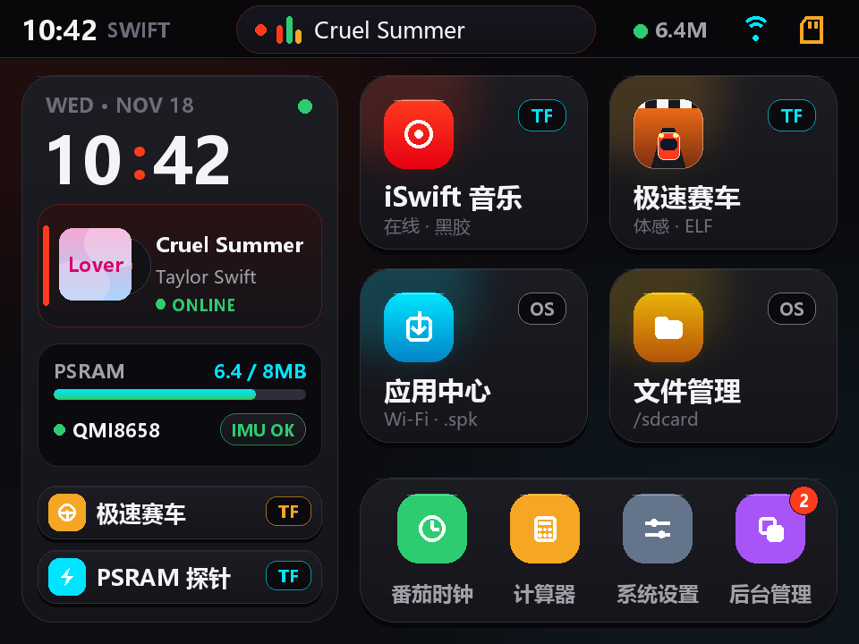
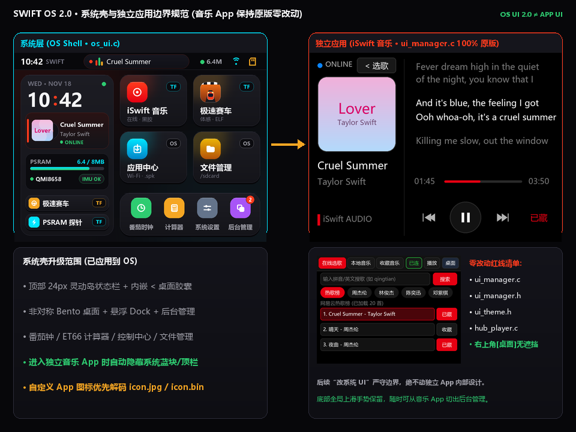

# G'lam OS — ESP32-S3 Dynamic PSRAM ELF Operating System

<p align="center">
  <b>面向 ESP32-S3 (16MB Flash + 8MB Octal PSRAM) 的动态 ELF 操作系统</b><br>
  320×240 LVGL 8.3 Bento 桌面 · 硬件级 Flash/TF 卡隔离 · 17 符号安全 ABI · 三通道 <code>.gla</code> 热安装
</p>

> 🔗 **配套第三方应用开发控制器与 SDK 仓库**：  
> 如果你是应用开发者，想要为 G'lam OS 编写、体检、打包 `.gla` 动态应用或使用零环境桌面控制器，请前往配套仓库：  
> 👉 **[G'lamor — G'lam OS 官方零环境开发控制器 & C/ELF SDK (`mark3268867477-spec/Glamor`)](https://github.com/mark3268867477-spec/Glamor)**  
> 📦 **[直接下载 Windows 零环境免安装版 `Glamor_v1.0.0_Win64_Portable.zip`](https://github.com/mark3268867477-spec/Glamor/releases/latest)**

---

## 一、 系统界面概览

| Bento 主桌面与动态磁贴 | G'lam Music 原生音乐中心 |
| :---: | :---: |
|  |  |
| **四大内置系统工具矩阵** | **三套热切换主题（经典深色 / 初雪 / 深邃）** |
|  |  |

---

## 二、 核心架构与特性

### 1. 硬件级 Flash 与 TF 卡物理隔离（永不刷砖 OS）
* **片内 16MB SPI Flash** 仅存放 G'lam OS 系统内核（`ota_0` / `ota_1` 分区）与底层驱动。
* **外部 MicroSD (TF) 卡** 存放所有用户与第三方应用（`/sdcard/apps/<app_id>/app.elf`）、沙盒存档（`/sdcard/data/<app_id>/`）及媒体文件（`/sdcard/music/`）。
* 安装或更新任何第三方 `.gla` 应用**全程在应用层写 TF 卡，100% 不触碰片内 Flash，无需重启设备**，桌面即装即用。

### 2. Xtensa ELF32 动态 PSRAM 加载器 (`swift_elf_loader`)
* 在 **8MB Octal PSRAM** 中分配 64 字节对齐内存块（数据总线 `DBUS 0x3Cxxxxxx`），并自动映射至指令总线别名（`IBUS 0x42xxxxxx`）。
* 解析 `SHF_ALLOC` 段与 `SHT_RELA` 重定位表（支持 `R_XTENSA_32`、`R_XTENSA_JMP_SLOT`、`R_XTENSA_RELATIVE`、`R_XTENSA_SLOT0_OP`）。
* 通过 `esp_cache_msync()` 自动完成 **D-Cache 回写 (`C2M`)** 与 **I-Cache 失效 (`M2C`)**，直接在扩展内存中以原生速度执行机器码。

### 3. 安全受控的内核 ABI (`glam_os_api_t` v1) 与 17 项符号白名单
* 动态应用通过 `glam_app_entry()` 获取内核注入的 `const glam_os_api_t *os` 函数表，安全调用 UI 控件、后台音频、沙盒存储、内存分配与网络状态接口。
* 内核符号导出表仅开放 **17 个安全白名单符号**（基础内存/字符串操作、I2C 传感器总线、LVGL 轻量位置/颜色/显隐接口），**严禁导出任何 Flash 擦写或分区操作符号**。

### 4. 三级后台生命周期策略 (`bg_policy`) 与防卡顿内存守卫
为保障 ESP32-S3 在 320×240 屏幕上始终保持流畅帧率，系统对所有应用实施三级后台管理：
1. **`kill_all`（退出即销毁）**：适用于游戏（如《极速赛车》）与一次性工具，返回桌面时立即调用 `on_destroy()` 并释放全部 PSRAM。
2. **`partial_service`（仅保留后台服务）**：适用于音乐播放与番茄钟，退出前台时释放 UI 控件，仅在音频播放或倒计时进行中保留后台服务槽位。
3. **`keep_all`（整应用挂起）**：适用于持续状态工具（如《内存检测》），返回桌面时完整保留 PSRAM 现场并自动冻结该应用的全部定时器（**后台 0% CPU 占用**），从底部上滑“后台管理”可 0 秒瞬时切回。
* **系统级防卡顿红线**：最多保留 `5` 个后台任务；当可用 PSRAM 低于安全水位时，内核按 LRU 自动回收挂起应用。

### 5. 三通道 `.gla` 安全应用安装器 (`os_spk_installer`)
系统原生支持 `.gla`（`GLAM` 魔数，并向下兼容旧版 `.spk` / `SWPK` 魔数），提供三种免刷机装包通道：
* **通道 1 — Wi-Fi 无线网页与 REST API**（端口 `80`）：
  * `GET /`：内置无线应用安装网页（手机/电脑浏览器直接上传 `.gla` 安装）
  * `POST /api/install`：接收 `.gla` 二进制流，校验 CRC32 与 Xtensa ELF 头后自动解包并提取 40×40 图标至 `/sdcard/apps/<id>/`
  * `GET /api/info` & `GET /api/apps`：查询系统内存水位与已安装应用列表
  * `POST /api/uninstall?id=<app_id>`：远程卸载应用
  * `GET /api/screenshot`：实时抓取 320×240 屏幕 24-bit BMP 快照（供 **[G'lamor](https://github.com/mark3268867477-spec/Glamor)** 控制器实时投屏）
* **通道 2 — USB 串口热推包**（UART0 / USB-Serial-JTAG `115200` bps）：
  * 在系统正常开机状态下通过 `gla_begin` / `gla_chunk` / `gla_end` JSON+Base64 协议安全写卡。
* **通道 3 — TF 卡离线导入**：
  * 将 `.gla` 放入 TF 卡 `/sdcard/install/`，开机或点击「应用中心 -> 扫描安装包」自动安装；或在「文件管理」中直接点击任意 `.gla` 文件一键安装。

---

## 三、 目标硬件配置与引脚定义

| 模块 | 型号 / 规格 | 接口与引脚定义 |
| :--- | :--- | :--- |
| **主控模组** | `ESP32-S3-WROOM-1-N16R8` | 双核 Xtensa LX7 @ 240MHz，16MB Quad Flash，8MB Octal PSRAM |
| **显示屏** | 2.0" IPS LCD `ST7789` (320×240) | SPI2: `MOSI=IO40`, `CLK=IO41`, `CS=PCA9557_IO0`, `DC=IO39`, `BL=IO42` |
| **电容触控** | `FT6X36` / `FT5x06` | I2C0: `SDA=IO1`, `SCL=IO2` (400kHz) |
| **音频链路** | `ES8311` DAC + `NS4150B` 功放 | I2C0 控制；I2S1: `MCLK=IO38`, `BCLK=IO14`, `WS=IO13`, `DOUT=IO45`, `PA_EN=PCA9557_IO1` |
| **六轴陀螺仪**| `QMI8658` (加速度计 + 陀螺仪) | I2C0 (`0x6A`)，可供动态 `.elf` 游戏通过白名单 I2C 接口直接读取 |
| **TF 卡槽** | MicroSD (FAT32) | SDMMC 1-Bit: `CMD=IO48`, `CLK=IO47`, `D0=IO21` (挂载于 `/sdcard`) |
| **物理 Home 键**| 板载按键 | `GPIO0`（短按随时返回 G'lam OS 主桌面） |

---

## 四、 仓库目录结构

```text
Glam-OS/
├── os_firmware/                  # ESP-IDF v5.5+ 系统内核固件工程
│   ├── components/
│   │   ├── bsp/                  # 硬件板级支持包 (LCD / Touch / ES8311 Audio / SDMMC / PCA9557)
│   │   └── swift_abi/            # Xtensa ELF32 PSRAM 加载器 + G'lam OS ABI v1 (glam_os_api.h)
│   ├── main/
│   │   ├── os_main.c             # G'lam OS 内核启动入口
│   │   ├── os_spk_installer.c    # 三通道 .gla/.spk 安装器 + HTTP/UART 服务
│   │   ├── wifi_portal.c         # Wi-Fi STA 管理与 NVS 持久化
│   │   ├── hub_player.c          # 内置音乐播放引擎与在线/本地曲库管理
│   │   └── ui/
│   │       ├── os_ui.c           # Bento 桌面、后台管理、设置、文件管理、应用中心、时钟、计算器
│   │       ├── os_kbd24.c        # 全局 24 键全屏中英拼音输入法键盘
│   │       ├── ui_manager.c      # G'lam Music 双栏播放器界面
│   │       └── ui_font_cjk_14.c  # GB2312 一二级汉字 + 符号 14px 2bpp 字库
│   ├── partitions.csv            # 16MB Flash 分区表
│   ├── build.bat                 # 一键编译脚本
│   └── flash.bat                 # 一键烧录脚本
├── docs/                         # 系统架构设计与刷写规范文档
│   ├── Glam_OS_系统架构设计.md
│   ├── 应用安装与系统刷写操作规范.md
│   └── images/                   # UI 预览截图
└── tools/                        # 字库与 UI 预览渲染脚本
```

---

## 五、 固件编译与烧录指南（仅针对 OS 内核开发）

> ⚠️ **注意**：如果你只是开发或安装桌面上的应用程序（`.gla`），**严禁运行 `flash.bat` 或 `idf.py flash`**！请直接使用 **[G'lamor 控制器](https://github.com/mark3268867477-spec/Glamor)** 通过 Wi-Fi / USB 串口 / TF 卡安装应用。

当修改了 `os_firmware/` 下的系统内核代码后，按以下步骤编译并刷新片内 Flash：

1. **环境要求**：Windows 10/11 + ESP-IDF `v5.5.x`（默认路径 `C:\Espressif\frameworks\esp-idf-v5.5.6`）。
2. **编译系统固件**：
   ```cmd
   cd os_firmware
   build.bat
   ```
   编译产物为 `os_firmware\build\glam_os.bin`。
3. **烧录至 ESP32-S3 片内 Flash**（默认端口 `COM7`，可传入实际串口号）：
   ```cmd
   cd os_firmware
   flash.bat COM7
   ```
   *刷新片内 Flash 不会影响外部 TF 卡 `/sdcard/apps/` 中已安装的任何应用与数据。*

---

## 六、 关联项目

* 🛠️ **[G'lamor (`mark3268867477-spec/Glamor`)](https://github.com/mark3268867477-spec/Glamor)**：G'lam OS 官方零环境 PC 控制器、C/ELF 应用开发 SDK、17 项 ABI 符号体检器与 `.gla` 打包安装工具。
