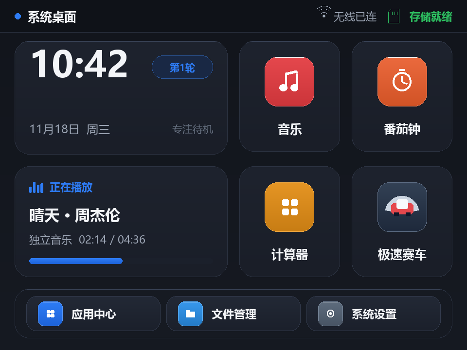

# G'lam OS — ESP32-S3 Dynamic PSRAM ELF Operating System

<p align="center">
  <b>A Dynamic PSRAM ELF32 Operating System for ESP32-S3 (16MB Flash + 8MB Octal PSRAM)</b><br>
  <b>面向 ESP32-S3 的动态 PSRAM ELF32 操作系统</b><br><br>
  <a href="#english-technical-documentation">English Technical Documentation</a> &nbsp;|&nbsp; <a href="#中文技术文档">中文技术文档</a> &nbsp;|&nbsp;
  <a href="https://github.com/mark3268867477-spec/Glamor">Companion PC Controller &amp; SDK (G'lamor)</a>
</p>

---

<a id="english-technical-documentation"></a>
# English Technical Documentation

> **Companion PC Toolchain & Third-Party App SDK Repository**:  
> **[G'lamor — Zero-Environment PC Controller & C/ELF SDK (`mark3268867477-spec/Glamor`)](https://github.com/mark3268867477-spec/Glamor)**  
> **[Download Portable Windows x64 Release `Glamor_v1.0.0_Win64_Portable.zip`](https://github.com/mark3268867477-spec/Glamor/releases/latest)**

---

## 1. System Overview & Core Technical Architecture

Conventional ESP32 firmware projects compile all features into a single monolithic binary, requiring full firmware recompilation and internal SPI Flash reflashing for every functional change. **G'lam OS** introduces a decoupled kernel-and-application architecture on the ESP32-S3, enabling independently compiled C binaries to be dynamically loaded and executed without touching internal Flash or rebooting the device.

### 1. 8MB Octal PSRAM Dual-Bus Native Execution Engine (`swift_elf_loader`)
Rather than interpreting bytecode or scripts, G'lam OS executes native Xtensa LX7 machine instructions directly from external PSRAM:
* **DBUS / IBUS Address Aliasing**: The loader parses standard ELF32 section headers, allocates a 64-byte-aligned contiguous block in 8MB Octal PSRAM (`DBUS 0x3Cxxxxxx`), and maps the corresponding executable instruction-bus alias (`IBUS 0x42xxxxxx`).
* **Relocation Processing**: Loads all `SHF_ALLOC` sections and resolves `SHT_RELA` relocations including `R_XTENSA_32`, `R_XTENSA_JMP_SLOT`, `R_XTENSA_RELATIVE`, and `R_XTENSA_SLOT0_OP`.
* **Cache Coherency Synchronization**: Invokes `esp_cache_msync()` after loading sections to perform **D-Cache writeback (`C2M`)** and **I-Cache invalidation (`M2C`)**, guaranteeing instruction fetch consistency.

### 2. Physical Isolation Between Internal Flash and External Storage
* **Kernel Domain (16MB Internal SPI Flash)**: Stores only the bootloader, G'lam OS kernel (`ota_0` / `ota_1`), hardware drivers, and system UI shell.
* **Application Domain (External MicroSD / TF Card)**: All user and third-party apps are installed to `/sdcard/apps/<app_id>/app.elf` from `.gla` packages, with isolated per-app storage under `/sdcard/data/<app_id>/`.
* **Zero-Flash-Wear Hot Deployment**: Installing, upgrading, or removing `.gla` packages operates exclusively on the TF card without erasing SPI Flash or rebooting.

### 3. Controlled Kernel ABI v1 & 17-Symbol Export Whitelist
* **Injected Function Table (`glam_os_api_t`)**: Upon invoking `glam_app_entry()`, the kernel passes a versioned `glam_os_api_t` pointer table into `on_create()` for logging, PSRAM heap allocation, safe UI widgets, background audio playback, sandboxed storage, and network status queries.
* **Audited 17-Symbol Whitelist**: Dynamic ELF linking is restricted to 17 whitelisted external symbols (`memcpy`, `memset`, `memmove`, `memcmp`, `strlen`, `strcmp`, `strncmp`, `snprintf`, 5 I2C master bus symbols, and 4 LVGL position/color/flag helpers). Direct Flash write or kernel task manipulation symbols are strictly unexported.

### 4. Three-Tier Background Lifecycle & Timer Suspension
Controlled via `bg_policy` in `manifest.json`:
1. **`kill_all`**: Immediately calls `on_destroy()` and frees all PSRAM allocations upon returning to the launcher.
2. **`partial_service`**: Releases foreground UI widgets while retaining a background service slot only while audio playback or a countdown timer is active.
3. **`keep_all`**: Preserves full PSRAM state and UI trees while automatically **suspending all app timers (0% background CPU utilization)**, enabling instant zero-latency resumption.
* **Memory Guardrail**: Enforces a maximum of `5` background entries and triggers LRU eviction if free PSRAM drops below the safety threshold.

### 5. Adaptive Multi-Board BSP & Peripheral Auto-Detection (`bsp_profiles`)
G'lam OS includes a runtime hardware-adaptive Board Support Package (`components/bsp/`) supporting multiple ESP32-S3 boards out of the box:
* **Safe I2C Bus Fingerprint Scanning (`bsp_auto_detect_board`)**: Scans safe candidate I2C pin pairs (avoiding Flash/Octal-PSRAM IO26–IO37) and identifies boards by peripheral ACK signatures (`PCA9557 0x19`, `FT6X36 0x38`, `CST816S 0x15`, `GT911 0x5D/0x14`, `ES8311 0x18`, `QMI8658 0x6A/0x6B`):
  * **LCSC ESP32-S3 (`lcsc_szp_s3`)**: `I2C IO1/IO2`, `PCA9557`, `ST7789 320x240`, `FT6X36`, `ES8311`, `SDMMC`
  * **Waveshare ESP32-S3-Touch-LCD-2 (`waveshare_s3_20`)**: `I2C IO48/IO47`, `ST7789 320x240`, `CST816S`, `SPI TF`
  * **Waveshare ESP32-S3-Touch-LCD-2.8 (`waveshare_s3_28`)**: `I2C IO1/IO3`, `ST7789 320x240`, `GT911`, `SDMMC`
  * **Waveshare ESP32-S3-Touch-LCD-1.69 (`waveshare_s3_169`)**: `I2C IO11/IO10`, `ST7789 280x240 (x_gap=20)`, `CST816T`
  * **Espressif ESP32-S3-BOX-3 (`espressif_box3`)**: `I2C IO8/IO18`, `ST7789 320x240`, `GT911`, `ES8311`
* **Adaptive Touch, Audio, IMU & Storage**: Auto-probes `FT5x06` -> `CST816S` -> `GT911` with graceful display-only fallback if no touch controller is found; supports both `SDMMC 1-Line` and `SPI TF` mounting; probes `ES8311` before audio init (graceful mute fallback if absent); probes `QMI8658` / `MPU6050` IMU addresses; and loads optional `/sdcard/board.json` overrides without recompilation.

### 6. `.gla` Package Format & Triple-Channel Distribution (`os_spk_installer`)
Each `.gla` archive contains a 160-byte binary header (`GLAM` magic, backward-compatible with `SWPK`), IEEE 802.3 CRC32 checksum, `manifest.json`, embedded 40×40 JPEG icon, and `app.elf`:
* **Channel 1 — Wi-Fi HTTP REST API (Port `80`)**: Web uploader (`GET /`), package installer (`POST /api/install`), telemetry & app list (`GET /api/info`, `GET /api/apps`), remote uninstaller (`POST /api/uninstall`), and 320×240 24-bit BMP framebuffer capture (`GET /api/screenshot`).
* **Channel 2 — USB Serial Hot Push (`115200` bps)**: Chunked `gla_begin` / `gla_chunk` / `gla_end` JSON+Base64 transfer over UART/USB-Serial-JTAG while the OS is running.
* **Channel 3 — Offline TF Card Installer**: Auto-scans `/sdcard/install/*.gla` or installs directly when tapped in the on-device File Manager.

---

## 2. System UI Previews

| Launcher & Status Cards (Classic Dark) | App Center & Custom Icon Resolution |
| :---: | :---: |
|  |  |
| **Built-in System Tools (Pomodoro / Calc / Settings / Files)** | **Real-Time Theme Comparison (Classic Dark / First Snow / Abyssal)** |
|  |  |

---

## 3. Default Reference Hardware Pinout (LCSC ESP32-S3)

| Subsystem | Hardware / Spec | Interface & Pinout |
| :--- | :--- | :--- |
| **SoC Module** | `ESP32-S3-WROOM-1-N16R8` | Dual-Core Xtensa LX7 @ 240MHz, 16MB Quad Flash, 8MB Octal PSRAM |
| **Display** | 2.0" IPS LCD `ST7789` (320×240) | SPI3: `MOSI=IO40`, `CLK=IO41`, `CS=PCA9557_IO0`, `DC=IO39`, `BL=IO42` |
| **Touch** | `FT6X36` / `FT5x06` Capacitive | I2C0: `SDA=IO1`, `SCL=IO2` (auto-probes `CST816S` / `GT911` on other boards) |
| **Audio** | `ES8311` DAC + `NS4150B` Amp | I2C0 Control; I2S1: `MCLK=IO38`, `BCLK=IO14`, `WS=IO13`, `DOUT=IO45`, `PA_EN=PCA9557_IO1` |
| **6-Axis IMU** | `QMI8658` / `MPU6050` | I2C0 (`0x6A` / `0x6B` / `0x68`), directly accessible by `.elf` apps via whitelisted I2C ABI |
| **TF Card** | MicroSD (FAT32) | SDMMC 1-Bit (`CMD=IO48`, `CLK=IO47`, `D0=IO21`) or SPI TF depending on board profile |
| **Home Button** | Tactile Key | `GPIO0` (returns to OS home screen) |

---

## 4. Building & Flashing the Kernel (OS Developers Only)

> **Note**: Do **not** run `flash.bat` to install desktop applications. Use **[G'lamor](https://github.com/mark3268867477-spec/Glamor)** to hot-install `.gla` packages to the TF card.

1. **Environment**: Windows 10/11 + ESP-IDF `v5.5.x` (`C:\Espressif\frameworks\esp-idf-v5.5.6`).
2. **Build**: Run `build.bat` inside `os_firmware/` to produce `os_firmware\build\glam_os.bin`.
3. **Flash**: Run `flash.bat COM7` (replace with your serial port). Existing apps on `/sdcard/apps/` are preserved.

---
---

<a id="中文技术文档"></a>
# 中文技术文档

> **配套 PC 端工具链与第三方应用 SDK 仓库**：  
> **[G'lamor — G'lam OS 零环境开发控制器与 C/ELF SDK (`mark3268867477-spec/Glamor`)](https://github.com/mark3268867477-spec/Glamor)**  
> **[下载 Windows 64 位零环境便携发行版 `Glamor_v1.0.0_Win64_Portable.zip`](https://github.com/mark3268867477-spec/Glamor/releases/latest)**

---

## 一、 系统定位与核心技术架构

传统 ESP32 固件普遍采用单体静态编译模式，新增或修改任何业务功能都需要重新编译整套工程并擦写片内 Flash。**G'lam OS** 在 ESP32-S3 微控制器上构建了一套完整的**内核与应用解耦架构**，使独立编译的 C 语言二进制程序能够在不刷写 Flash、不重启系统的前提下动态装载并运行。

### 1. 八兆字节 Octal PSRAM 双总线原生执行引擎 (`swift_elf_loader`)
G'lam OS 不依赖字节码虚拟机或脚本解释器，而是直接运行原生 Xtensa LX7 机器码：
* **DBUS / IBUS 双总线地址映射**：加载器解析标准 ELF32 节头表，按 64 字节对齐在外部 8MB Octal PSRAM 中分配合并内存块（数据总线虚拟地址 `DBUS 0x3Cxxxxxx`），并自动换算为对应的指令总线可执行别名地址（`IBUS 0x42xxxxxx`）。
* **完整重定位表解析**：读取所有 `SHF_ALLOC` 节与 `SHT_RELA` 重定位节，完整处理 `R_XTENSA_32`、`R_XTENSA_JMP_SLOT`、`R_XTENSA_RELATIVE` 与 `R_XTENSA_SLOT0_OP` 等 Xtensa 架构重定位类型。
* **多级缓存一致性同步**：在将代码段写入 PSRAM 数据视图后，调用 `esp_cache_msync()` 主动执行 **D-Cache 回写 (`C2M`)** 与 **I-Cache 失效 (`M2C`)**，确保 CPU 指令预取单元能够立即从 PSRAM 指令总线正确取指执行。

### 2. 片内 Flash 与外部 TF 卡物理隔离架构
* **内核固化域（片内 16MB SPI Flash）**：仅存放 G'lam OS 启动引导、系统内核（`ota_0` / `ota_1`）、硬件抽象层与核心服务。
* **应用运行域（外部 MicroSD / TF 卡）**：所有桌面应用均以 `.gla` 包形式安装至 `/sdcard/apps/<app_id>/app.elf`，应用专属数据隔离存储在 `/sdcard/data/<app_id>/`。
* **零 Flash 损耗热安装**：安装、更新或卸载任何应用全程仅对 TF 卡文件进行操作，100% 不触发片内 Flash 擦写，系统无需重启即可在桌面动态挂载并启动新应用。

### 3. 受控内核 ABI v1 与 17 项导出符号白名单
* **指针表服务注入 (`glam_os_api_t`)**：内核在调用应用入口 `glam_app_entry()` 后，通过 `on_create()` 注入包含系统日志、PSRAM 堆管理、安全 UI 控件、后台音频调度、沙盒文件读写与网络状态查询在内的受控 ABI 函数表。
* **17 项最小化符号白名单**：动态链接器仅允许解析以下 17 个外部符号，严禁导出任何 SPI Flash 擦写、分区操作或任务破坏接口：
  * **基础内存与字符串 (8)**：`memcpy`、`memset`、`memmove`、`memcmp`、`strlen`、`strcmp`、`strncmp`、`snprintf`
  * **I2C 传感器总线 (5)**：`bsp_i2c_get_handle`、`i2c_master_bus_add_device`、`i2c_master_bus_rm_device`、`i2c_master_transmit`、`i2c_master_transmit_receive`
  * **LVGL 高频渲染辅助 (4)**：`lv_obj_set_pos`、`lv_obj_set_style_bg_color`、`lv_obj_add_flag`、`lv_obj_clear_flag`

### 4. 三级后台生命周期调度与低内存防卡顿守卫
由应用 `manifest.json` 中的 `bg_policy` 声明：
1. **`kill_all`（退出即销毁）**：切回桌面时立即触发 `on_destroy()`，回收定时器、UI 节点及全部 PSRAM 占用。
2. **`partial_service`（服务保活模式）**：退出前台时释放图形控件树，仅在音频解码或倒计时进行中保留后台服务槽位，任务结束后自动回收。
3. **`keep_all`（现场挂起与 0% CPU 冻结）**：完整保留 PSRAM 代码段、全局变量与 UI 对象树，内核自动**暂停该应用的全部周期定时器（后台 0% CPU 占用）**；从后台任务管理切回时可零延迟恢复运行现场。
* **资源水位保护**：系统限制最大后台挂起任务数为 `5` 个；当剩余可用 PSRAM 低于安全阈值时，内核按 LRU 自动回收挂起现场。

### 5. 多板卡硬件自适应 BSP 引擎 (`bsp_profiles`)
为使 G'lam OS 能够适配不同厂商的 ESP32-S3 屏幕开发板，`components/bsp/` 内建了运行时多板卡探测与容错机制：
* **安全 I2C 总线指纹识别 (`bsp_auto_detect_board`)**：自动避开 Flash/Octal-PSRAM 引脚（`IO26~IO37`），依次探测主流开发板的安全 I2C 引脚组合，通过读取外设芯片 ACK 指纹自动匹配板型配置：
  * **立创·实战派 ESP32-S3 (`lcsc_szp_s3`)**：`I2C IO1/IO2`、`PCA9557 (0x19)`、`ST7789 320×240`、`FT6X36 (0x38)`、`ES8311`、`SDMMC 1-Line`
  * **微雪 Waveshare ESP32-S3-Touch-LCD-2 (`waveshare_s3_20`)**：`I2C IO48/IO47`、`ST7789 320×240`、`CST816S (0x15)`、`SPI TF 卡`
  * **微雪 Waveshare ESP32-S3-Touch-LCD-2.8 (`waveshare_s3_28`)**：`I2C IO1/IO3`、`ST7789 320×240`、`GT911`、`SDMMC 1-Line`
  * **微雪 Waveshare ESP32-S3-Touch-LCD-1.69 (`waveshare_s3_169`)**：`I2C IO11/IO10`、`ST7789 280×240 (x_gap=20)`、`CST816T (0x15)`
  * **乐鑫 ESP32-S3-BOX-3 (`espressif_box3`)**：`I2C IO8/IO18`、`ST7789 320×240`、`GT911`、`ES8311`
* **外设自动探测与优雅降级**：
  * **触控自适应**：内置 `FT6X36/FT5x06`、`CST816S/T`、`GT911` 原生驱动并自动探测；无触控板卡可优雅降级为纯显示+按键模式启动。
  * **存储与音频自适应**：根据板型自动选择 `SDMMC 1-Line` 或 `SPI TF` 挂载；音频初始化前先探测 `ES8311` 芯片，无音频芯片时自动进入静音降级模式不阻塞开机。
  * **IMU 探测与 TF 卡免编译覆盖**：自动探测 `QMI8658 (0x6A/0x6B)` 与 `MPU6050 (0x68/0x69)`；挂载 TF 卡后自动加载 `/sdcard/board.json` 进行免编译参数覆盖。

### 6. `.gla` 二进制封装格式与三通道安全分发 (`os_spk_installer`)
* **通道 1 — Wi-Fi HTTP REST API（端口 `80`）**：网页上传（`GET /`）、安装校验（`POST /api/install`）、状态查询（`GET /api/info`、`GET /api/apps`）、远程卸载（`POST /api/uninstall`）与 320×240 BMP 实时抓屏（`GET /api/screenshot`）。
* **通道 2 — USB 串口热传输（`115200` bps）**：通过 `gla_begin` / `gla_chunk` / `gla_end` JSON+Base64 分块协议安全写入 TF 卡。
* **通道 3 — TF 卡离线扫描与文件管理直装**：自动扫描 `/sdcard/install/*.gla` 或在文件管理器中点击直接安装。

---

## 二、 系统界面展示

| 主桌面与信息卡片（经典深色） | 应用中心与自定义图标解析 |
| :---: | :---: |
|  |  |
| **内建工具矩阵（番茄钟 / 计算器 / 设置 / 文件与任务）** | **三套实时主题对比（经典深色 / 初雪 / 深邃）** |
|  |  |

---

## 三、 默认参考硬件引脚（立创·实战派 ESP32-S3）

| 模块 | 型号 / 规格 | 接口与引脚定义 |
| :--- | :--- | :--- |
| **主控模组** | `ESP32-S3-WROOM-1-N16R8` | 双核 Xtensa LX7 @ 240MHz，16MB Quad Flash，8MB Octal PSRAM |
| **显示屏** | 2.0" IPS LCD `ST7789` (320×240) | SPI3: `MOSI=IO40`, `CLK=IO41`, `CS=PCA9557_IO0`, `DC=IO39`, `BL=IO42` |
| **电容触控** | `FT6X36` / `FT5x06` | I2C0: `SDA=IO1`, `SCL=IO2`（支持自动探测 `CST816S` / `GT911`） |
| **音频链路** | `ES8311` DAC + `NS4150B` 功放 | I2C0 控制；I2S1: `MCLK=IO38`, `BCLK=IO14`, `WS=IO13`, `DOUT=IO45`, `PA_EN=PCA9557_IO1` |
| **六轴传感器**| `QMI8658` / `MPU6050` | I2C0 (`0x6A` / `0x6B` / `0x68`)，动态 `.elf` 应用可通过白名单 I2C 接口直接读取 |
| **TF 卡槽** | MicroSD (FAT32) | SDMMC 1-Line (`CMD=IO48`, `CLK=IO47`, `D0=IO21`) 或 SPI TF（随板型自动切换） |
| **物理 Home 键**| 板载按键 | `GPIO0`（短按返回系统主桌面） |

---

## 四、 仓库目录结构与内核编译指南

```text
Glam-OS/
├── os_firmware/                  # ESP-IDF v5.5+ 系统内核固件工程
│   ├── components/
│   │   ├── bsp/                  # 自适应多板卡 BSP (profiles / CST816S / GT911 / FT5x06 / SDMMC+SPI / ES8311)
│   │   └── swift_abi/            # Xtensa ELF32 PSRAM 加载器 + G'lam OS ABI v1 (glam_os_api.h)
│   ├── main/                     # 内核入口、三通道安装器、Wi-Fi、音乐引擎与 LVGL 系统 UI
│   ├── partitions.csv            # 16MB Flash 分区表
│   ├── build.bat                 # 一键编译脚本 (产物: build/glam_os.bin)
│   └── flash.bat                 # 一键烧录脚本 (示例: flash.bat COM7)
├── docs/                         # 系统架构设计与界面预览图
└── tools/                        # 字库生成与 UI 渲染脚本
```

> **提示**：开发或安装桌面应用程序（`.gla`）**不需要运行 `flash.bat`**，请使用 **[G'lamor](https://github.com/mark3268867477-spec/Glamor)** 进行免刷机热安装。仅在修改 `os_firmware/` 内核源码时需要重新烧录片内 Flash（烧录内核不会影响 TF 卡中的已安装应用）。

1. **编译环境**：Windows 10/11 + ESP-IDF `v5.5.x`（默认路径 `C:\Espressif\frameworks\esp-idf-v5.5.6`）。
2. **编译内核**：进入 `os_firmware` 目录执行 `build.bat`，生成 `os_firmware\build\glam_os.bin`。
3. **烧录内核**：执行 `flash.bat COM7`（替换为实际串口号）。
