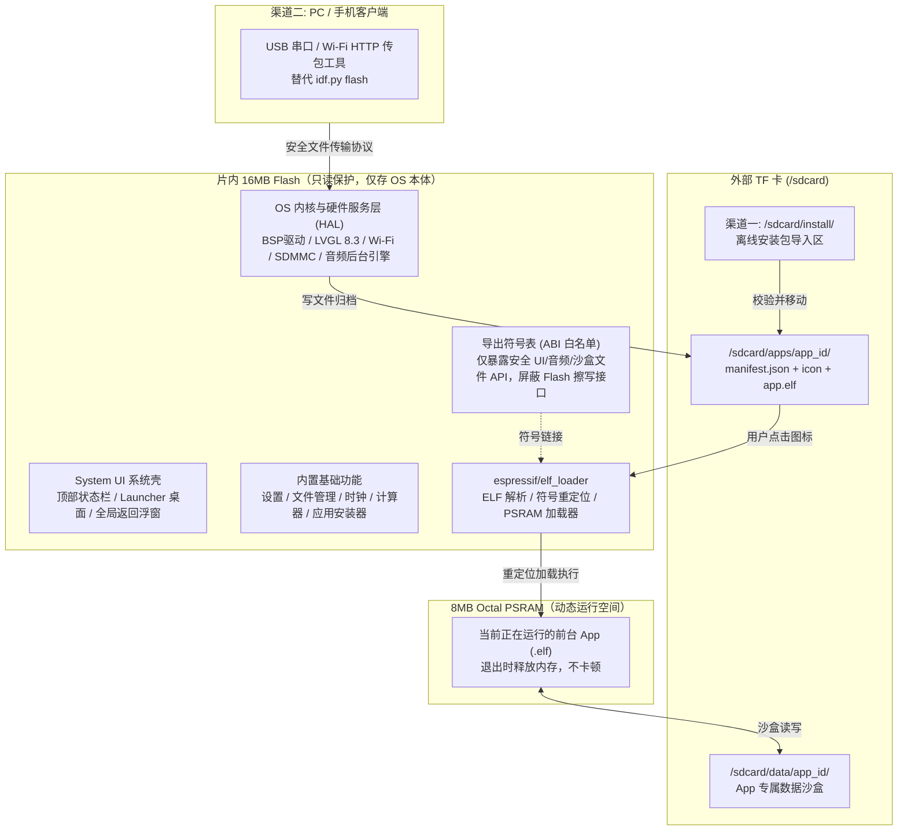

# SWIFT OS 架构与实现方案（ESP32-S3 动态 ELF 版）

> **核心定位**：基于 **立创开发板 · 实战派 (ESP32-S3-WROOM-1-N16R8)** 打造的轻量级类手机桌面操作系统。  
> **核心特性**：片内 Flash **只存 OS 内核与基础系统功能**；第三方/自研 App 统一编译为 `.elf` 存放在 **TF 卡**，点开时通过 `espressif/elf_loader` 动态加载至 **8MB Octal PSRAM** 运行，退出即释放；提供 **TF 卡离线导入（渠道一）** 与 **USB/Wi-Fi 无线投包（渠道二）** 两种安全安装方式，从协议与权限层面杜绝外部程序覆盖 OS。

---

## 1. 硬件与软件底座（基于现有工程）

本方案直接复用现有工程 [playpal_iswift_hub](file:///c:/Users/Mark/Desktop/esp32/playpal_iswift_hub) 已验证的硬件驱动与外设引脚定义：

| 模块 | 芯片/规格 | 通信接口与说明 |
| :--- | :--- | :--- |
| **主控** | ESP32-S3-WROOM-1-N16R8 | 双核 240MHz，**16MB Quad Flash** + **8MB Octal PSRAM (80MHz)** |
| **缓存** | 片上 Cache | 32KB Instruction Cache + 64KB Data Cache |
| **屏幕** | ST7789V (320×240 横屏) | SPI3 (80MHz)，由 `lvgl (~8.3.0)` + `esp_lvgl_port` 驱动 |
| **触控** | FT6X36 电容触摸 | I2C (`0x38`)，坐标映射 320×240 |
| **IO 扩展** | PCA9557PW | I2C (`0x19`)，控制 `LCD_CS`、`PA_EN`、`DVP_PWDN` |
| **音频** | ES8311 DAC + NS4150B 功放 | I2S1 + I2C (`0x18`)，复用现有 `components/bsp/bsp_audio` |
| **外部存储** | MicroSD (TF 卡) | SDMMC 1-Bit，挂载点 `/sdcard`，支持 FATFS 长文件名（UTF-8 / CP936） |
| **开发环境** | ESP-IDF v5.5.6 | CMake 构建体系 |

> [!WARNING]
> **路径空格提醒**：当前总目录命名为 `SWIFT OS`（含空格），而 **ESP-IDF 的 CMake/Ninja 构建工具链对路径中的空格极其敏感，可能导致 `idf.py build` 失败**。后续正式新建固件源码工程时，建议将源码放在无空格路径下（例如将本目录改名为 `SWIFT_OS`，或把源码工程放在 `c:\Users\Mark\Desktop\esp32\swift_os_fw`）。

---

## 2. 总体系统架构（方案 A：OS 常驻 + PSRAM 动态 ELF）

为了解决嵌入式设备上“装很多 App 不占 Flash、同时跑起来不卡、还能后台听歌”的矛盾，SWIFT OS 采用 **微内核服务 + 单前台动态 App** 架构：



### 为什么这套架构不会卡？
1. **未启动的 App 零开销**：TF 卡里存 50 个、100 个 `.elf` 文件，既不占用 Flash，也不占用 PSRAM 和内部 SRAM。
2. **“单前台 + 退即卸载”防止内存与 Cache 抖动**：同一时刻只在 PSRAM 中加载运行 **1 个** 前台外部 App。用户返回桌面时，OS 销毁其创建的 LVGL 页面/定时器，并调用 `esp_elf_deinit()` 完整归还 PSRAM，避免多个大体积应用互相争抢 32KB I-Cache 与 ~512KB 内部 SRAM。
3. **系统级“音频后台服务”实现边听歌边操作**：把 MP3/WAV 硬件解码与 ES8311 播放能力**下沉到 OS 内核层**作为常驻服务。即使退出音乐 App 界面（`.elf` 已被卸载释放），音乐依然可以在后台播放，顶部状态栏保留迷你播放胶囊。

---

## 3. 存储与目录规范

### 3.1 片内 16MB Flash 分区表（`partitions.csv`）
Flash 中**不再给外部 App 分配执行槽位**，全部空间只服务于 OS 本体升级与系统内置资源（字库、系统图标、铃声等）：

```csv
# Name,     Type, SubType, Offset,   Size,   Flags
nvs,        data, nvs,     0x9000,   0x6000,
otadata,    data, ota,     0xf000,   0x2000,
phy_init,   data, phy,     0x11000,  0x1000,
ota_0,      app,  ota_0,   0x20000,  4M,
ota_1,      app,  ota_1,   0x420000, 4M,
sys_res,    data, fat,     ,         7M,
```
* **`ota_0` / `ota_1`**：仅用于 **SWIFT OS 自身系统升级**（双备份防变砖）。
* **`sys_res`**：内部 FAT 分区，存放 OS 内置中文字库、系统壁纸、内置小图标，即使拔掉 TF 卡 OS 也能正常开机进桌面。

### 3.2 TF 卡目录结构规范（`/sdcard`）
```text
/sdcard/
├── install/                     # 【渠道一】离线安装包投放目录（*.spk 或解压包）
├── apps/                        # OS 管理的标准 App 安装目录（Launcher 扫描此目录）
│   ├── com.swift.music/
│   │   ├── manifest.json        # App 元数据（名称、版本、入口、权限声明）
│   │   ├── icon.bin             # 48x48 或 64x64 LVGL 图标（RGB565）
│   │   └── app.elf              # 编译好的可重定位 ELF 程序
│   └── com.swift.calc/
│       └── ...
├── data/                        # App 沙盒数据目录（按 app_id 隔离）
│   └── com.swift.music/
│       └── playlist.json
└── music/                       # 用户媒体公共目录（歌曲、LRC 歌词、封面等）
```

### 3.3 `manifest.json` 规范示例
```json
{
  "id": "com.swift.music",
  "name": "iSwift 音乐",
  "version": "1.0.0",
  "api_level": 1,
  "entry": "app.elf",
  "icon": "icon.bin",
  "permissions": ["audio", "network", "media_read"]
}
```

---

## 4. 类手机 System UI 与基础功能设计（320×240 横屏）

### 4.1 全局界面框架
1. **顶部状态栏（320 × 24 px，常驻最高图层）**：
   * 左侧：当前时间（联网 NTP 自动校准）+ 后台音乐播放微状态点（点击可快速呼出播放控制弹窗或跳回音乐 App）。
   * 右侧：Wi-Fi 信号图标、SD 卡挂载图标、当前音量/亮度快速状态。
2. **主桌面 Launcher（320 × 216 px）**：
   * **分页图标网格**：每页 `4 列 × 2 行 = 8 个图标`（64×64 图标含圆角与标签），支持左右手势滑动翻页，底部带页面指示点。
   * **底部悬浮 Dock（可选或整合在滑出栏）**：固定放 3~4 个高频入口（文件、音乐、安装器、设置）。
3. **全局系统返回机制**：
   * 在任何 `.elf` App 运行时，可通过 **屏幕顶部状态栏下滑 / 左侧边缘右滑 / 物理 BOOT 键短按** 呼出系统控制浮层（提供“返回桌面”、“音量/亮度调节”、“强行结束当前 App”），保证即使第三方 App 卡死界面，用户也能随时切回桌面。

### 4.2 内置“手机基础功能”（直接编译进 OS，零延迟开启）
| 基础功能 | 核心能力 |
| :--- | :--- |
| **系统设置 (Settings)** | Wi-Fi 扫描与配网、屏幕背光 PWM 调节（`IO42`）、ES8311 全局音量、时间设置、系统信息（SRAM/PSRAM/Flash/TF 卡余量查看）、OS 本地 OTA 升级 |
| **文件管理器 (Files)** | 浏览 `/sdcard` 目录、查看文件大小、删除文件、点击 `.spk`/`.elf` 直接触发安装、点击音频文件直接调用系统音乐服务试听 |
| **应用管理器 (App Manager)** | 查看已安装的 TF 卡 App、查看占用空间、卸载 App（清理 `/sdcard/apps/<id>` 及可选清理沙盒数据） |
| **时钟与番茄钟 (Clock)** | 数字时钟/桌面翻页钟、倒计时、番茄钟（复用现有音频发声提醒） |
| **简易计算器 (Calculator)** | 触控四则运算小工具 |

---

## 5. 动态 ELF 加载机制与现有音乐软件改造

### 5.1 `espressif/elf_loader` 配置要点
1. 在 OS 主工程 `idf_component.yml` 引入官方组件：
   ```yaml
   dependencies:
     espressif/elf_loader: "2.*"
   ```
2. `menuconfig` 开启：
   * `CONFIG_ELF_LOADER_LOAD_PSRAM=y`（将 ELF 代码段与数据段加载到 8MB Octal PSRAM，保护内部 SRAM）。
   * 开启 OS 与 PSRAM Cache 同步支持。

### 5.2 OS 导出 ABI 接口表（`swift_os_api.h`）
App 不直接操作底层驱动（如 `i2c_driver`、`spi_bus`、`esp_lcd`），而是通过 **OS 导出的标准 C 函数指针表 / 符号表** 工作：

```c
// App 标准生命周期入口（每个 .elf 必须实现）
typedef struct {
    int  (*on_create)(lv_obj_t *app_root, const char *data_dir, const char *args);
    void (*on_destroy)(void);
} swift_app_entry_t;
```

**OS 向 `.elf` 开放的 4 类安全能力：**
1. **UI 能力**：LVGL 8.3 基础控件与字体 API（OS 统一管理屏幕刷新锁，App 只在传入的 `app_root` 容器内绘制界面）。
2. **音频服务 API**：`os_audio_play(path)`、`os_audio_pause()`、`os_audio_seek()`、`os_audio_get_spectrum()`（由 OS 内核线程驱动 ES8311，App 无需自己初始化 I2S）。
3. **网络与系统 API**：HTTP 请求封装、当前 Wi-Fi 状态查询、弹窗提示 `os_toast()`、系统返回请求 `os_exit_app()`。
4. **沙盒存储 API**：`os_fopen` / `os_fread` / `os_fwrite`（自动限制或映射在 `/sdcard/data/<app_id>/` 与只读媒体目录）。

### 5.3 如何把现有的 [playpal_iswift_hub](file:///c:/Users/Mark/Desktop/esp32/playpal_iswift_hub) 变成第一个 TF 卡 App？
将现有音乐工程拆分为“两半”：
* **下沉到 OS 内核的公共部分**：
  * `components/bsp`（板级初始化、屏幕、触控、SD 卡、ES8311 音频解码与功放控制）
  * `wifi_portal`（全系统只需连一次 Wi-Fi）
  * `hub_protocol`（可选升级为全系统的 PC 伴侣通道，不止服务于音乐）
* **保留在音乐 App（编译为 `com.swift.music/app.elf`）的业务部分**：
  * `ui/ui_manager.c`（左侧黑胶唱盘卡片 + 右侧 3 行滚词/14 频段频谱 + 4 个控制键）
  * `lrc_parser.c`、`netease_api.c`、`cover_fetcher.c`
  * 把原来自己调 `bsp_audio` 的地方改为调用 `os_audio_*` 接口，原本退出或切换模式处增加“返回 OS 桌面”入口。

---

## 6. 绝对防覆盖：双渠道安装体系（渠道一 + 渠道二）

要保证**任何人写的 ESP32 程序都不会把 OS 顶掉，而是老老实实进 `/sdcard/apps/`**，核心原则是：**彻底弃用 `idf.py flash` / `esptool` 刷机方式，由正在运行的 OS 接管安装写入过程。**

### 6.1 统一安装包格式：`.spk`（Swift Package）
为了同时服务渠道一和渠道二，定义一个极简安装包格式 `.spk`（本质为一个未压缩或标准打包文件，内部包含文件头校验 + 多个文件条目）：
```text
[Magic: "SWPK" (4B)] [Version (2B)] [AppID_Len + AppID] [FileCount]
  ├── manifest.json
  ├── icon.bin
  └── app.elf
```
> **安全校验**：安装包头部与 `app.elf` 在写入前必须经过 OS 校验：
> 1. 校验 `"SWPK"` 魔数与 `manifest.json` 合法性（`app_id` 不得含 `..` 或 `/` 等路径穿越字符）；
> 2. 校验 `app.elf` 前 4 字节为标准 ELF 头 `\x7fELF` 且架构为 Xtensa (ESP32-S3)，**拒绝任何普通 `.bin` 固件或非 ELF 文件**。

### 6.2 渠道一：TF 卡离线导入
* **适用场景**：无电脑、或批量分享他人做好的 App 包。
* **流程**：
  1. 用户把他人发布的 `xxx.spk`（或包含 `manifest.json` + `app.elf` 的文件夹）拷进 TF 卡 `/sdcard/install/`。
  2. 在 OS 打开“应用安装器”或重启自检，OS 扫描 `/sdcard/install/`，逐项展示 App 名称与权限，用户点击“安装”。
  3. OS 校验通过后，将文件解包写入 `/sdcard/apps/<app_id>/`，随后删除 `/sdcard/install/` 中的原包并刷新桌面。

### 6.3 渠道二：USB 串口 & Wi-Fi 一键无线投包（替代 `idf.py flash`）
* **适用场景**：开发者在自己电脑上写完代码，希望像以往烧录那样“敲一条命令就立刻装进设备调试”。
* **方案 2A：USB 串口协议投包（无 Wi-Fi 也能用）**
  * OS 常驻监听 USB-Serial（可与现有 `hub_protocol` 共用帧头分流，遇到 `{"cmd":"app_install", ...}` 进入高速二进制接收态）。
  * 我们提供一个 PC 端脚本 `swift_install.py`：
    ```bash
    python swift_install.py COM7 build/my_app.spk
    ```
  * 传输协议流程：
    1. PC 发送安装握手包（含 `app_id`、总字节数、整包 CRC32）。
    2. OS 检查 TF 卡剩余空间，返回 `READY`。
    3. PC 按 4KB 分片发送数据（每片带序号和 CRC），OS **直接写入 `/sdcard/apps/<app_id>/.tmp`**（全程不触碰 Flash）。
    4. 传输结束并核对整包 CRC32 无误后，OS 原子重命名为正式目录并发送 `INSTALL_OK`，桌面自动刷新图标。
* **方案 2B：Wi-Fi 局域网网页/HTTP 投包（最友好）**
  * OS 开启轻量 `esp_http_server`，提供一个极简上传页面（`http://<esp32-ip>/install`）及 POST 接口 `POST /api/install`。
  * **普通用户**：手机或电脑浏览器打开该地址，直接把 `.spk` 或 `.elf` 拖进网页即可完成安装。
  * **开发者**：`swift_install.py --wifi 192.168.1.xx build/my_app.spk` 一键无线推送，连数据线都不用插。

### 6.4 为什么能 100% 防止“把 OS 顶掉”？
| 风险点 | 防护手段 |
| :--- | :--- |
| **误用 `idf.py flash` 覆盖 Flash** | 提供 **SWIFT OS App SDK 模板工程**，模板中**删除 `flash.bat`**，改为 **`install.bat`**（内部自动调用编译器生成 `.elf` → 打包 `.spk` → 调用 `swift_install.py` 发给 OS）。开发者的日常操作闭环被引导至“打包投包”，不会进入 ROM 下载模式。 |
| **恶意或 Bug 代码在运行时擦写 OS 分区** | `espressif/elf_loader` 采用**白名单符号导出表**：OS **绝对不导出** `esp_partition_erase_range`、`esp_partition_write`、`esp_flash_write`、`esp_ota_*` 等底层 Flash 修改函数。App 代码哪怕自己写了相关调用，在重定位链接阶段就会直接报错并被 OS 拒绝启动。 |
| **App 写坏系统关键文件** | OS 提供的文件接口仅允许读写 `/sdcard/data/<app_id>/` 与媒体目录，禁止写入 `/sdcard/apps/` 以外的系统保留路径。 |

---

## 7. 开发者 SDK 模板结构规划

为了让其他人能快速给 SWIFT OS 写 App，整体项目拆分为两个清晰的子目录：

```text
SWIFT_OS/ (注意正式编译时建议目录名不含空格)
├── SWIFT_OS_方案设计.md          # 本文档
├── os_firmware/                  # 【OS 内核工程】（烧录进 ESP32-S3 Flash）
│   ├── CMakeLists.txt
│   ├── partitions.csv
│   ├── components/
│   │   ├── bsp/                  # 复用现有硬件 BSP
│   │   └── swift_abi/            # 导出给 ELF 的符号表与沙盒 API
│   └── main/
│       ├── os_main.c             # 系统启动、挂载 SD 卡、初始化内核服务
│       ├── os_audio_service.c    # 后台音频播放服务
│       ├── os_app_manager.c      # ELF 加载器 + .spk 安装解包 + 桌面扫描
│       ├── os_installer_srv.c    # 渠道二：USB 串口 & Wi-Fi HTTP 安装接收端
│       └── ui/                   # 状态栏、Launcher 桌面、设置、文件管理等
├── app_sdk_template/             # 【开发者 App 模板】（给所有人写 App 用）
│   ├── include/swift_os_api.h    # OS 暴露的统一头文件
│   ├── main/app_main.c           # 示例 Hello World / 音乐 App 模板
│   ├── manifest.json             # App 信息配置
│   ├── pack_spk.py               # 将编译产物打包成 .spk
│   └── install.bat               # 一键编译并调用 swift_install.py 安装到 TF 卡
└── tools/
    └── swift_install.py          # PC 端 USB/Wi-Fi 无线装包工具
```

---

## 8. 分阶段落地路线图

为了确保每一步都能真机验证、稳步推进，建议按以下 **4 个里程碑** 推进：

1. **Milestone 1：OS 桌面壳与基础硬件底座（预计 1~2 天）**
   * 搭建 `os_firmware` 工程，复用 `playpal_iswift_hub` 的 `bsp` 与 LVGL 8.3。
   * 完成顶部状态栏、320×240 分页 Launcher 桌面、设置页（Wi-Fi/亮度/音量）、文件管理器。
2. **Milestone 2：打通“渠道一 + 渠道二”安装链路（预计 1 天）**
   * 实现 `.spk` 打包规范与 TF 卡 `/sdcard/install/` 自动导入。
   * 实现 `swift_install.py`（USB 串口 + Wi-Fi HTTP 上传），实现不插拔卡、不重烧 Flash 直接把文件写进 `/sdcard/apps/`。
3. **Milestone 3：跑通 `espressif/elf_loader` 动态加载（预计 1~2 天）**
   * 在 OS 端集成 `espressif/elf_loader`（开启 PSRAM 加载），导出最小可用符号表（LVGL + 日志 + 退出回调）。
   * 做出 `app_sdk_template`，编译一个带按钮的 Demo `hello.elf`，验证从桌面点击启动 → PSRAM 运行 → 退出完全释放内存的闭环。
4. **Milestone 4：系统音频服务与“iSwift 音乐”迁移（预计 2~3 天）**
   * 将 ES8311 MP3/WAV 播放封装进 `os_audio_service.c` 并导出给 `.elf`。
   * 将现有 [playpal_iswift_hub](file:///c:/Users/Mark/Desktop/esp32/playpal_iswift_hub) 的 UI 与歌词/频谱逻辑迁移为标准 `com.swift.music` 应用包，实现**桌面点击启动音乐 + 退出回到桌面依然后台听歌**的完整体验。
