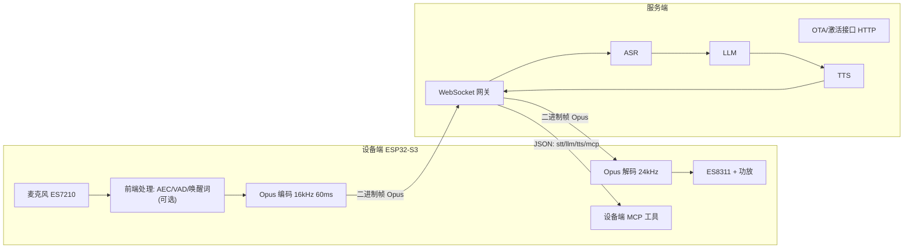
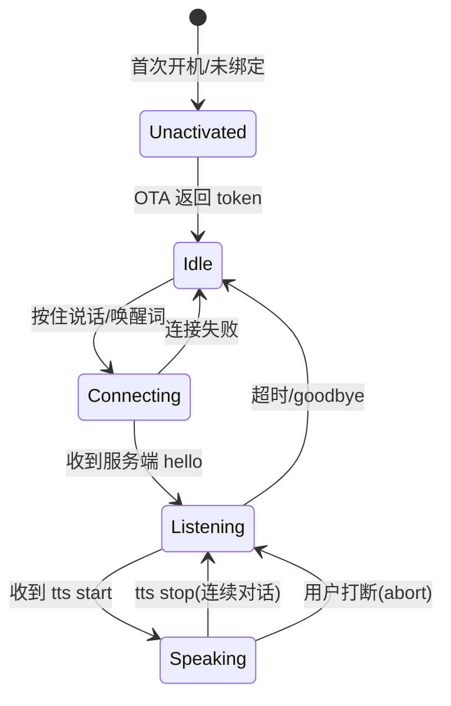

# 小智 AI（xiaozhi-esp32）集成到 G'lam OS：分析说明书与操作指南

> 版本：v0.1（调研稿）　|　日期：2026-11-20　|　编写：哈基米
> 适用固件：`Glam-OS/os_firmware`（ESP-IDF v5.5.6 + LVGL 8.3），默认硬件档案 `lcsc_szp_s3`（立创·实战派 ESP32-S3）

---

## 0. 结论摘要

| 问题 | 结论 |
|---|---|
| 能不能做？ | **能。** 小智固件以 MIT 协议开源，而且上游**官方就支持立创·实战派 ESP32-S3**（板型 `lichuang-dev`），和我们的默认硬件是同一块板子。 |
| 能不能直接把源码塞进来？ | **不建议。** 上游用 C++ 写、依赖 LVGL 9、自带分区表和整套应用框架；G'lam OS 用 C 写、依赖 LVGL 8.3。硬合并的成本比自己重写还高。 |
| 推荐路线 | **方案 B：在 G'lam OS 里原生实现「小智协议客户端」**，做成一个系统服务加一个「小智」应用。服务端直接用小智官方云（xiaozhi.me），或者用开源服务端自己部署。 |
| 最大技术缺口 | 我们的 BSP 目前**只开了播放通道**（`BSP_I2S_DI_IO = -1`），板载麦克风 ADC（ES7210）还没驱动；另外还需要加上 Opus 编解码。 |
| 预估工作量 | 先做按键说话的 MVP：约 1～2 周；加上唤醒词、AEC 打断、MCP 控制系统：再加 1～2 周。 |

---

## 1. 小智 AI 是什么

- **仓库**：GitHub `78/xiaozhi-esp32`（MIT 协议，允许修改和商用）
- **定位**：基于 ESP32 的实时语音 AI 助手。设备只负责「采音、播音、显示、执行硬件动作」，ASR（语音识别）、LLM（大模型）、TTS（语音合成）全部在服务端完成。
- **生态**：
  - 官方云控制台：xiaozhi.me（用 6 位验证码绑定设备，在后台选模型、音色、角色）
  - 社区开源服务端：`xinnan-tech/xiaozhi-esp32-server`（Python，支持 Docker，自带 Web 智控台），另有 Java、Go 等版本

### 1.1 系统架构



### 1.2 通信协议要点（WebSocket 版）

> [!NOTE]
> 以下内容是根据上游 `docs/websocket.md` 的公开资料整理的。正式开发前，请拿当时上游最新版逐字段核对一遍，协议版本可能会变。

1. **激活/配置（HTTP）**：设备开机后向 OTA 地址发一次 POST，请求头带 `Device-Id`（MAC 地址）和 `Client-Id`（UUID），请求体里是设备信息。服务端会返回 WebSocket 地址、Token 和固件版本信息；如果设备还没绑定，还会返回一个 **6 位激活码**，屏幕显示出来后到控制台输入即可绑定。
2. **建立 WebSocket 连接**：请求头带上 `Authorization: Bearer <token>`、`Protocol-Version: 1`、`Device-Id` 和 `Client-Id`。
3. **握手**：设备先发 `hello` 消息：
   ```json
   {"type":"hello","version":1,"transport":"websocket","features":{"mcp":true},
    "audio_params":{"format":"opus","sample_rate":16000,"channels":1,"frame_duration":60}}
   ```
   服务端回一个 `hello`，里面带 `session_id` 和下行音频参数（一般是 24000Hz 的 Opus）。
4. **对话**：
   - 设备发 `{"type":"listen","state":"start","mode":"manual|auto|realtime"}`，然后上行发送 Opus 二进制帧。
   - 服务端下发 `stt`（识别出的文字）、`llm`（表情/情绪）、`tts`（`start` / `sentence_start` 带文字 / `stop`），中间穿插 Opus 二进制音频帧。
   - 打断用 `{"type":"abort"}`；设备控制走 `{"type":"mcp","payload":{JSON-RPC 2.0}}`。

---

## 2. 与 G'lam OS 的匹配度分析

### 2.1 硬件匹配（立创·实战派 ESP32-S3）

| 资源 | 小智需要 | 我们的板子 / 当前固件 | 结论 |
|---|---|---|---|
| 主控 | ESP32-S3 | ESP32-S3 (QFN56) rev v0.2 | ✅ |
| Flash / PSRAM | 推荐 16MB + 8MB | 16MB Flash + 8MB Octal PSRAM（80MHz） | ✅ |
| 播放 | I2S DAC + 功放 | ES8311 + NS4150B，I2S1（MCLK 38 / BCK 14 / WS 13 / DOUT 45），功放使能在 PCA9557 上 | ✅ 已在用 |
| 录音 | I2S 麦克风 / ADC | 板载 **ES7210 多通道 ADC**，但 BSP 里 `BSP_I2S_DI_IO = -1`，**没有驱动** | ⚠️ 需新增驱动 |
| AEC 回采 | 可选 | 上游 `lichuang-dev` 配置开启了 `AUDIO_INPUT_REFERENCE`（ES7210 有一路接的是播放回采） | ⚠️ 可选，能做到对话中打断 |
| 屏幕 / 触摸 | 可选 | 320×240 + FT5x06 | ✅ |
| 按键 | BOOT 键说话 | **GPIO0 已经被 G'lam OS 用作「回桌面」硬件键** | ⚠️ 改用屏幕按钮或唤醒词 |
| 网络 | Wi-Fi 2.4G | 已有 `wifi_portal`（国家码 CN） | ✅ |

> [!IMPORTANT]
> ES7210 的 I2S 数据输入脚（`DIN`）和 I2C 地址请以**上游 `main/boards/lichuang-dev/config.h` 和立创原理图**为准，接入前必须实测确认。这份文档没有写死这两个值。

### 2.2 软件栈对比

| 维度 | xiaozhi-esp32 上游 | G'lam OS | 影响 |
|---|---|---|---|
| 语言 | C++（类继承的板级抽象） | C | 不能直接链接上游的 Application / Board 框架 |
| GUI | LVGL 9 | LVGL 8.3（`lvgl/lvgl ~8.3.0`） | **硬冲突**，上游 UI 代码全部要重写 |
| ESP-IDF | 5.4+ | 5.5.6 | ✅ 兼容 |
| 编解码组件 | `esp_codec_dev`、Opus、`esp-sr` | 已有 `espressif/esp_codec_dev ~1.3.0` | 只需补 Opus（以及可选的 esp-sr） |
| 分区表 | 自带（含模型/资源分区） | `ota_0/ota_1` 各 4M，`storage` 7M FAT | 唤醒词模型需要从 `storage` 里划一块出来 |
| 音频占用 | 独占 I2S | 音乐播放器（esp-audio-player）独占 I2S1 发送 | 需要做**音频仲裁** |
| 应用模型 | 单一固件 | 系统内核 + TF 卡 `.gla` ELF 应用 | AI 服务适合放内核，界面可以做成内置视图 |

### 2.3 资源预算（估算值，接入后以 `idf.py size` 实测为准）

| 项目 | 估算 | 余量 |
|---|---|---|
| 固件体积增量 | Opus 约 0.3MB，WebSocket/JSON 增量很小；esp-sr 唤醒词库另计 | 当前 `glam_os.bin` 为 `0x2426f0`（约 2.26MB），4MB 分区还剩约 44% ✅ |
| 唤醒词模型 | WakeNet 模型约 0.3～1MB（看具体模型） | 需要新增 `model` 分区（从 `storage` 7M 里划） |
| PSRAM | Opus 编解码状态、环形缓冲、TLS，约 0.5～1MB | 8MB PSRAM 充足 ✅ |
| 内部 SRAM | TLS 握手和 Wi-Fi 是主要压力 | 需要关注，大缓冲一律放 PSRAM |
| CPU | Opus 16k 编码 + 24k 解码 + AFE | S3 双核 240MHz 可以承受；AFE 固定在 Core 1，UI 放 Core 0 |

---

## 3. 集成方案对比

| 方案 | 做法 | 优点 | 缺点 | 评价 |
|---|---|---|---|---|
| **A. 双系统** | 把原版小智固件刷到 `ota_1`，在 G'lam OS 里加一个「切换到小智」入口（改 otadata 后重启） | 最快，功能和官方完全一致 | 两个系统互相切换要重启；小智固件自带分区表和 NVS 布局，可能冲掉 G'lam OS 的 NVS（Wi-Fi、主题等）；UI 风格割裂 | 只适合**硬件验证**，不适合长期 |
| **B. 原生协议客户端（推荐）** | 在 G'lam OS 内核新增 `xz_service`（C 实现协议、音频、状态机），再加一个原生「小智」视图 | 和系统深度融合：共用 Wi-Fi、24 键键盘、主题、音乐播放器仲裁；MCP 能直接控制系统功能 | 要自己写音频管线和协议 | ✅ **长期最优** |
| C. 移植上游 C++ 框架 | 把上游 `Application` / `AudioService` / `Protocol` 拷进来，UI 部分改写成 LVGL 8 | 能复用上游的成熟逻辑 | 依赖多、C/C++ 混编、以后跟进上游升级很痛苦 | 不推荐 |

---

## 4. 推荐方案 B：详细设计

### 4.1 模块划分（新增文件，路径相对 `os_firmware/`）

| 文件 | 职责 |
|---|---|
| `components/bsp/src/bsp_mic.c` + `include/bsp_mic.h` | ES7210 初始化；I2S1 改成全双工（TX 接 ES8311，RX 接 ES7210）；对外输出 16kHz 单声道 PCM（可选同时输出回采通道） |
| `main/xz/xz_audio.c/.h` | 采集 → (AFE) → Opus 编码，Opus 解码 → 播放；所有环形缓冲放 PSRAM |
| `main/xz/xz_protocol.c/.h` | OTA 激活请求（`esp_http_client`）、WebSocket（`esp_websocket_client`）、`hello` / `listen` / `abort` / `mcp` 的收发与 JSON 解析（cJSON） |
| `main/xz/xz_service.c/.h` | 状态机、和音乐播放器的音频仲裁、对 UI 发事件 |
| `main/xz/xz_mcp.c/.h` | 设备端 MCP 工具注册（JSON-RPC 2.0 的 `tools/list`、`tools/call`） |
| `main/ui/os_xz_view.c` | 「小智」界面：表情/状态、STT 和 TTS 字幕、按住说话按钮、激活码显示 |
| `main/idf_component.yml` | 新增依赖：Opus 编解码组件、`espressif/esp_websocket_client`；可选 `espressif/esp-sr` |

### 4.2 状态机



### 4.3 音频仲裁规则（和音乐 App 共存）

1. 小智进入 `Listening` / `Speaking` 时：调用音乐播放器暂停（或把音量压低到约 20% 做「避让」），记录下原来的播放状态。
2. 小智回到 `Idle` 时：恢复音乐播放状态。
3. I2S1 统一由 BSP 以**全双工常开**的方式管理，播放数据源在「音乐解码器」和「Opus 解码」之间切换，**不要反复卸载、重装 I2S 驱动**。

### 4.4 MCP：把系统能力开放给 AI（示例工具）

| 工具名 | 参数 | 对接的现有能力 |
|---|---|---|
| `self.audio.set_volume` | `volume: 0-100` | `bsp_audio` 音量 |
| `self.screen.set_brightness` | `level: 0-100` | 设置页亮度 |
| `self.theme.set` | `name: 经典深色/初雪/深邃` | `apply_chrome_theme_styles()` |
| `self.music.play` / `pause` / `next` | `keyword?` | `hub_player`（在线搜歌/本地播放） |
| `self.system.get_status` | — | Wi-Fi、内存、SD 卡状态 |

> 说法示例：「小智，把主题换成深邃」「放一首周杰伦的晴天」「音量调到 30」。

### 4.5 入口与交互

- 桌面新增「小智」磁贴，进入全屏视图（视图规范和 `VIEW_SETTINGS` 一致）。
- 屏幕底部放一个大按钮「按住说话」（手动模式），松手后发送 `listen stop`。
- 二期加入唤醒词「你好小智」（esp-sr WakeNet，常驻后台）。为了省电和避免误唤醒，需要在设置里提供开关。
- 状态栏加一个 AI 状态小图标（聆听中 / 说话中）。

---

## 5. 风险与合规

| 风险 | 说明 | 对策 |
|---|---|---|
| 官方云服务条款 | xiaozhi.me 免费额度、接口稳定性和商用限制，以官方公告为准 | 产品化时优先**自建服务端**，或者和官方确认商用授权 |
| 协议变更 | 上游协议在持续迭代（如 `Protocol-Version`） | 协议层单独封装，版本号做成可配置 |
| 隐私 | 语音会上传到服务端 | 在 UI 上明确提示；默认不开启常驻唤醒；支持自建服务端 |
| 内部 SRAM 不足 | TLS + Wi-Fi + LVGL 同时运行 | 大缓冲全部放 PSRAM；mbedTLS 开启动态缓冲 |
| GPIO0 冲突 | 和「回桌面」键冲突 | 不复用 BOOT 键，改用屏幕按钮 / 唤醒词 |
| 开源协议 | 上游是 MIT | 如果参考或复制上游代码，需要保留它的版权声明 |

---

## 6. 操作指南

### 6.1 第 0 步：用原版小智固件验证硬件（可选，约 30 分钟）

> [!CAUTION]
> 刷原版小智固件会**覆盖 G'lam OS**，包括 NVS 里保存的 Wi-Fi 和主题设置。TF 卡上的应用（`/sdcard/apps/`）不受影响。验证完以后按 6.1.4 刷回去即可。

1. **下载源码**（在 Windows 上，路径里不要有空格）：
   ```powershell
   cd C:\Users\Mark\Desktop\esp32
   git clone https://github.com/78/xiaozhi-esp32.git
   ```
2. **选板型并编译**（用现有的 ESP-IDF v5.5.6 环境）：
   ```cmd
   set PATH=C:\Espressif\python_env\idf5.5_py3.11_env\Scripts;C:\Espressif\tools\idf-git\2.44.0\cmd;%PATH%
   call C:\Espressif\frameworks\esp-idf-v5.5.6\export.bat
   cd /d C:\Users\Mark\Desktop\esp32\xiaozhi-esp32
   idf.py set-target esp32s3
   idf.py menuconfig
   ```
   在 `Xiaozhi Assistant → Board Type` 里选 **立创实战派 ESP32-S3 开发板（lichuang-dev）**，保存后执行：
   ```cmd
   idf.py build
   idf.py -p COM7 flash monitor
   ```
   > 上游也提供现成的 Release 固件。菜单项名称以上游当前版本为准。
3. **配网与绑定**：
   1. 设备第一次启动会开一个 `Xiaozhi-xxxx` 热点。用手机连上，在弹出的网页里填家里的 **2.4G** Wi-Fi。
   2. 屏幕上会显示 6 位验证码。登录 xiaozhi.me 控制台 →「添加设备」→ 输入验证码。
   3. 在控制台里选择大模型、音色和角色提示词。
   4. 按 BOOT 键或者说「你好小智」，开始对话。
   - **验收**：能正常对话，说明 ES7210 麦克风、ES8311 播放和网络链路在这块板子上都是好的。
4. **刷回 G'lam OS**：
   ```cmd
   cd /d C:\Users\Mark\Desktop\esp32\Glam-OS\os_firmware
   idf.py -p COM7 erase-flash
   idf.py -p COM7 flash
   ```
   > `erase-flash` 会把小智残留的分区和 NVS 一起清掉。刷完后，Wi-Fi 需要在「设置 → 配置网络」里重新连接。

### 6.2 服务端选择

**方案 ①：官方云（上手最快）**
- 不需要部署，设备用默认 OTA 地址即可。缺点是受官方额度和条款限制。

**方案 ②：自建开源服务端（适合深度定制或产品化）**
1. 准备一台局域网里的 Linux 主机、NAS 或 Windows（需要 Docker Desktop）。
2. 部署：
   ```bash
   git clone https://github.com/xinnan-tech/xiaozhi-esp32-server.git
   cd xiaozhi-esp32-server
   # 按仓库 README 选择「全模块 Docker」或「仅 Server」部署方式
   docker compose up -d
   ```
3. 在配置文件或 Web 智控台里填入 ASR / LLM / TTS 的 API Key（例如通义千问、DeepSeek、豆包等）。
4. 记下服务端给出的 **OTA 地址**和 **WebSocket 地址**（形如 `http://<局域网IP>:<端口>/xiaozhi/ota/`、`ws://<局域网IP>:<端口>/xiaozhi/v1/`，具体以服务端启动日志为准）。
5. G'lam OS 里需要提供「小智设置 → 服务器地址」输入框（用系统 24 键键盘输入），保存到 NVS。

### 6.3 G'lam OS 集成开发步骤（方案 B）

每个阶段都要求编译通过、字库检查 `Missing non-ASCII glyphs: 0`，并在真机上验收后再进入下一阶段。

| 阶段 | 内容 | 验收标准 |
|---|---|---|
| **P0 麦克风打通** | 新增 `bsp_mic`：I2S1 全双工 + ES7210；做一个调试页显示麦克风电平条 | 对着麦克风说话时电平条明显跳动；同时播放音乐不受影响 |
| **P1 Opus 回环** | 接入 Opus 组件：录 3 秒 → 编码 → 解码 → 播放 | 回放清晰、无爆音；用串口日志记录单帧编码耗时 |
| **P2 激活与连接** | `xz_protocol`：OTA POST → 显示 6 位激活码 → WebSocket 连接 → 收发 `hello` | 能在控制台完成绑定；串口打印出服务端回的 `session_id` |
| **P3 按住说话 MVP** | `xz_service` 状态机 + `os_xz_view` 界面 + 音乐避让 | 按住说「今天天气怎么样」能听到回答，屏幕上显示 STT 和 TTS 字幕；对话结束后音乐自动恢复 |
| **P4 MCP 系统控制** | `xz_mcp`：注册 4.4 节里的工具 | 语音能切换主题、调音量、点歌 |
| **P5 增强（可选）** | esp-sr 唤醒词、AEC 打断、`model` 分区 | 「你好小智」能唤醒；AI 说话时可以直接插话打断 |

**分区调整示例（P5 才需要，会改动 FAT 区，务必先备份 `storage` 数据）：**
```csv
# Name,     Type, SubType, Offset,   Size
nvs,        data, nvs,     0x9000,   0x6000,
otadata,    data, ota,     0xf000,   0x2000,
phy_init,   data, phy,     0x11000,  0x1000,
ota_0,      app,  ota_0,   0x20000,  4M,
ota_1,      app,  ota_1,   0x420000, 4M,
model,      data, spiffs,  ,         1M,
storage,    data, fat,     ,         6M,
```

### 6.4 最终用户使用流程（集成完成后）

1. 「设置 → 配置网络」连上 2.4G Wi-Fi。
2. 桌面点「小智」，第一次进入时屏幕会显示 6 位激活码，到 xiaozhi.me（或自建智控台）完成绑定。
3. 按住「按住说话」开始提问，松手等待回答；也可以直接说出控制指令（换主题、调音量、点歌）。
4. 从底部上滑，可以把小智挂到后台；音乐会在对话结束后自动恢复。

### 6.5 常见问题排查

| 现象 | 可能原因 | 处理 |
|---|---|---|
| 一直不显示激活码 | 没联网，或者 OTA 地址填错 | 先检查 Wi-Fi 状态；串口看 OTA 请求返回的 HTTP 状态码 |
| 连上了但对方听不到 | ES7210 没初始化，或者 DIN 引脚 / 采样率不对 | 回到 P0 的电平条调试页排查 |
| 回答声音变快或变慢 | 下行采样率（24k）和 I2S 采样率不一致 | 按服务端 `hello` 里的 `audio_params` 动态设置采样率，或者做重采样 |
| AI 说话时自己把自己打断 | 没做 AEC，外放声音被麦克风录进去了 | 开启回采通道 + AFE AEC；或者在 `Speaking` 期间暂停上行 |
| 内存不足导致重启 | TLS 和大缓冲占用了内部 SRAM | 缓冲改用 `MALLOC_CAP_SPIRAM`；开启 mbedTLS 动态缓冲 |

---

## 7. 待你决策的事项

1. **服务端**：先用官方云快速出效果，还是一开始就自建服务端？
2. **是否先做 6.1 的硬件验证**（需要临时覆盖 G'lam OS 固件）？
3. **MVP 范围**：先做「按住说话 + 字幕」，唤醒词和打断放到二期，是否同意？
